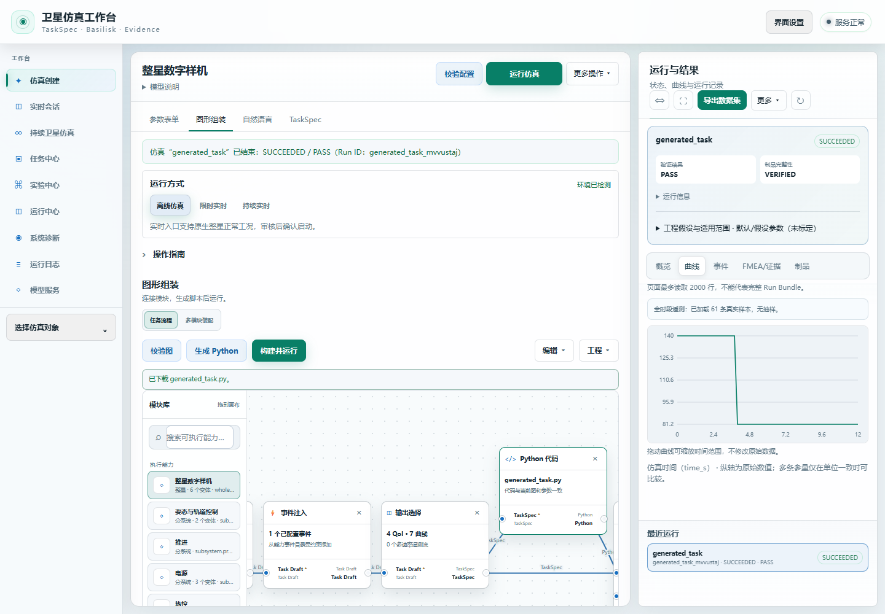
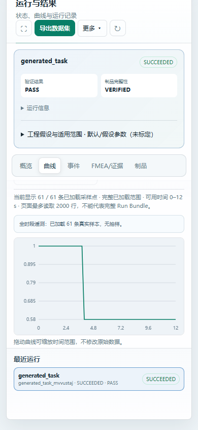
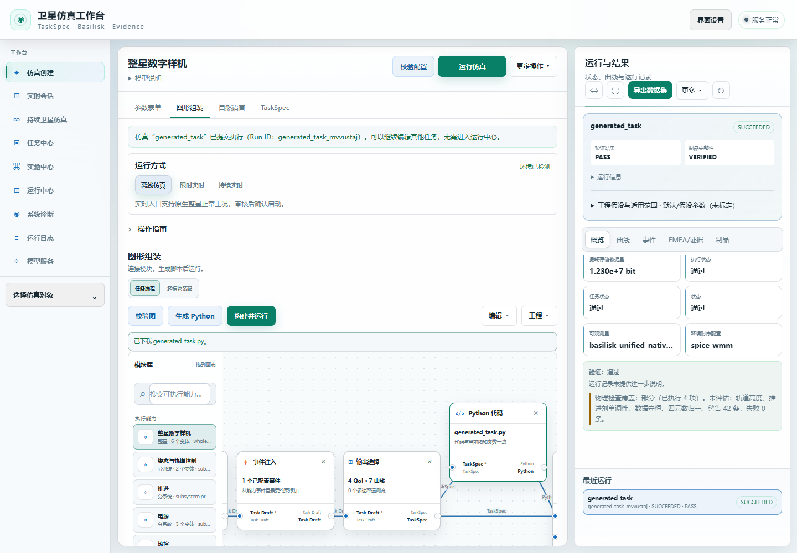

# 最终代码集成验收

本次将已验证的脚本生成、任务保真、异常输入处理和精简界面合入实际项目源码。整体验收仍为 **ACTIVE / UNPROVEN**，24 小时耐久实例尚未结束。

- AI 历史失败的固定 15 例：15 次真实首答、15 个原始导出脚本执行成功、15 次密封运行复核通过；见 [结果](ai-fixed15-result.json)和[独立复核](ai-fixed15-independent-review.json)。[原始回答](ai-first-responses/)逐条保留。旧 69 例严格评分没有改写，本次结果不代表新的 69/69。
- 最终安装态界面：真实创建 17% 电池容量损失场景，再基于原配置修改为 42%；下载的两个原始脚本和同页运行共 3 次原生执行通过。92 项流程检查通过，见[原始结果](installed-gui-result.json)。页面曲线显示 140 Wh → 81.2 Wh、容量比例 1 → 0.58，保留 42 条物理警告与部分覆盖说明。
- 独立 uv/Python 3.12 环境安装了 90 个锁定依赖及项目 wheel，869 项源码、wheel、安装载荷逐字节一致。仅支持本轮实际验证的 Windows 环境，不据此宣称其他平台通过。
- 首次最终全量测试有 5 个异常输入处理失败；修复仅涉及参数检查提前调用规范化的问题，原始失败与断言保留。修复后相关 186 项通过；最终全量 **2500 通过、0 失败、6 跳过、2 警告**，退出码 0，源码指纹和导入来源稳定。见 [JUnit](full-junit.xml)和[终态记录](full-returned.json)。[主目录合入记录](source-adoption.json)确认实际替换 94 个文件，没有删除文件。

本机最终安装态入口为 http://127.0.0.1:56149 。模型服务使用同一实际微调的 v5 适配器，模型代码冻结于 R47；安装后的产品源码另有异常输入修复及 R48 界面集成。源码、模型服务和耐久实例的版本范围分别披露，不混加测试分数。

新耐久实例从北京时间 2026-10-31 06:50 独立开始，物理运行核心与本次集成相同。旧实例只留下约 20.5 小时记录，没有合格终态，原因未定；新实例不继承旧时长。通用近地小卫星工程假设、误差边界和未评估物理量保留，不声称飞行验证或硬件标定。

