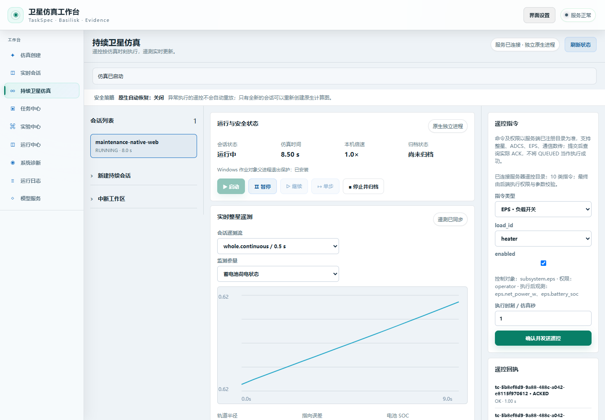
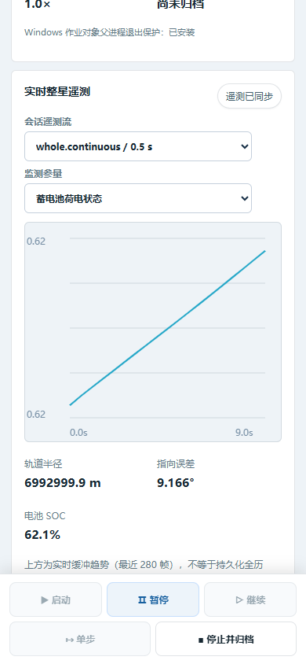

# 最终功能验收报告（2026-11-02）

**结论：本次约定范围内的功能开发与本地验收完成，可以交付。** 范围为 Windows 上的通用近地小卫星工程仿真、离线与软实时运行、AI 创建/修改脚本及图形界面。异常中止后保留证据、重新创建场景；不要求跨进程恢复同一原生状态。24小时按用户明确选择的原始证据复核方式验收，不重跑、不改写原自动判定。本报告随最新修复提交；云端是否交付以实际 Git 提交和远端分支核对为准。

| 原始要求 | 验收证据 | 结论与范围 |
|---|---|---|
| 使用 uv 创建环境 | 新建独立 Python 3.12 环境，90项锁定依赖及项目 wheel；869项运行载荷的源码、wheel、安装文件逐字节一致 | Windows 实测通过；详见 `environment-proof.json`、`build-install-proof.json` |
| 完善的单次离线、实时仿真 | 当前全部2516项用例完整分段覆盖；独立安装态4项浏览器测试；实际Basilisk 10秒短程和13秒网页流程均完成、密封且任务验证PASS | 按约定用途完成；短程不冒充24小时，不保证硬实时或原生跨进程续算 |
| 卫星配置与工况真实性 | 原生Basilisk、SPICE/WMM、4轮配置、4 W/K热连接及既有参数/步长/参考对照；物理与校验实现除只读终态观察器外沿用已验收版本 | 通用近地工程模型，披露假设和误差边界；物理覆盖PARTIAL，不代表目标卫星标定或飞行认证 |
| AI助力创建脚本 | 既有15次真实首答的原始脚本执行、密封结果复核通过；另有2次安装态真实创建/修改模型调用及3次原生运行；本次确认AI代码未改变 | 受约束创建/修改功能完成；本次没有重新训练、没有新增模型推理，不外推任意自然语言可靠性 |
| 前后端交互与可视化 | 精简工具栏、折叠低频操作、键盘/窄屏布局；修复遥控可用状态冲突和RW4选择；真实当前安装态网页流程11项检查全部通过 | 功能与已测布局通过，不作“绝对无缺陷”承诺；实际截图见下 |

## 当前版本与回归结果

本地原始字节指纹 App：`c1e78f413430cf846a96023ecbf000d97f1fa156f59dea38dd59f5c96cabf70e`；Core：`079eb54d91fe398d441ca817ea76cc3cce7ac725e32c28725208cbeff04a1cd0`。wheel SHA-256：`76f1cf2884692635a214bb734efa8a3d87d8435af5b5a32647ce23d22a99cce8`。869项运行载荷对应当前源码及独立安装态；wheel构建候选中的测试辅助文件不作为本次最终测试版本，最终318份测试文件另行绑定。Git文本换行转换后的源码身份用 `source-normalized-hashes.json` 补充核对，不能混用本地原始字节指纹。

**当前集合2516项：2511通过、5跳过、最终未解决失败0、遗漏0、重复成功0。** 这是六次执行按准确用例身份合并的完整覆盖，**不是一次单命令全绿**。原始失败JUnit保留，只有下列两项失败被明确复验结果接续；中止运行的63个进度点不作证据。应用运行代码在这些执行间未改变；测试夹具改动和未打包治理脚本的改动分别复验。

| 执行段 | 原始通过 | 原始失败 | 跳过 |
|---|---:|---:|---:|
| original_full | 1200 | 1 | 5 |
| finite_revalidated | 1 | 0 | 0 |
| remaining_first | 977 | 1 | 0 |
| run_panel_revalidated | 1 | 0 | 0 |
| governance | 10 | 0 | 0 |
| tail | 322 | 0 | 0 |

`coverage.json`、`expected-cases.json`、六份原始JUnit及五份执行返回记录支持逐用例重算。成功前缀只复用未改变测试模块的结果，318份测试文件哈希和治理脚本哈希已重新核验。五项跳过对应实验性原生电池检查点配置、Linux父进程死亡信号、两项POSIX SIGKILL故障注入及Linux上的Windows作业对象负向用例；它们不计通过。Windows原生作业对象实际测试已执行。独立定向23项、安装态浏览器4项及真实网页11项属于补充检查，不重复加到2511中。

## 最新修复及失败处理

1. 终态观察器在停止收尾时补采**实际已经发生**的终态，保留旧行；仍处STOPPING时不会捏造完成，观察失败仍标为INCOMPLETE_ERROR，FAILED/ABORTED/INTERRUPTED不取得完成资格。新增6项回归，原代码5失败1通过；当前相关23项通过，并由真实原生短程验证。
2. 遥控发送按钮统一依赖所选会话、READY/RUNNING/PAUSED状态、服务器命令合同、目录加载和发送在途状态；目录晚到、目录失败和发送期间字段切换不能误启用。确定性浏览器对照原代码2失败，修复通过。
3. RW4选项同时要求4轮配置、服务器字段声明及实际有限数值遥测，避免目录刷新把选项短暂启用后清掉用户选择。原代码真实DOM对照1失败，修复及刷新选择保留通过。
4. 工具栏测试改为仅依赖当前检出，全部布局、键盘和项目往返断言保留；历史前后对照继续保存在原R48证据包。
5. 有限常量解码测试曾触及原90秒边界。夹具复用真实tokenizer预处理，实际构建1次、复用5次，每次仍创建独立解析器/请求状态；17项真实语法检查全部通过，原90秒门限未放宽，无权重加载、网络或CUDA。生产模型代码未改变。[LM Format Enforcer上游说明](https://github.com/noamgat/lm-format-enforcer/blob/main/lmformatenforcer/tokenenforcer.py)支持复用tokenizer预处理。
6. 运行面板测试改为等待真实页面和指定运行就绪，保留全部VERIFIED、布局、曲线及模型状态断言；不以后台轮询下的networkidle判断就绪。[Playwright官方文档](https://playwright.dev/docs/api/class-page#page-wait-for-load-state)不建议以networkidle进行测试就绪判断。普通优先级复验通过；不能把优先级单独解释为已证明的唯一原因，也不据此作性能资格声明。
7. 治理扫描在遍历前应用原有顶层排除策略，避免先扫描环境、模型和报告再丢弃结果；不新增排除项，嵌套的违规脚本仍检出。原实现1项失败，修复后10项通过。此前中止的慢扫描保留，不用进度点代替成功结果。

## 真实安装态与界面

当前独立安装态使用真实原生监督进程。13秒网页场景通过公共表单配置SPICE/WMM、4轮和4 W/K，EPS遥控收到实际ACKED，最终COMPLETED、SEALED、任务PASS、末条观察COMPLETED。1440×1000桌面和390×844窄屏无横向溢出，有实际SOC曲线，无页面错误。两张原图已人工查看。模型请求计数前后均17，没有新增推理；服务发现只证明既有模型可发现，不冒充新一轮生成探测。新安装配置的完整探测状态如实为CONFIGURED_NOT_TESTED；先前真实生成证据按其原版本保留。





## 保留的验收边界

24小时原实例连续RUNNING为86426.172秒，172861条节拍无缺口，48个固定及16927个滚动窗口满足200毫秒P95预算，13项密封载荷重新校验完整。末次周期观察为STOPPING，0.814671秒后原状态链记录COMPLETED。因此原自动 **NOT_QUALIFIED** 不改，按用户选择形成的[独立原始证据复核验收](../manual-endurance-review-2026-11-01/README.md)单独有效。该旧实例不是当前修复版本的新24小时资格。4.0701114秒漂移峰值、timing_status=DEGRADED、131731条逐采样物理警告及部分物理检查未评估全部保留；旧约20.5小时失败实例不计通过。

AI旧69例严格评分0/69、原回答诊断54/69、最终对象严格比较0/69均不改写。新15例通过不是新69/69；物理覆盖仍PARTIAL。没有取消严格门禁、替换原始回答、模板冒充模型或据短程宣称24小时通过。原[最终集成证据](../final-integration/README.md)及24小时复核证据包的全部载荷哈希重新核验未变。

## 复核本报告

```powershell
python reports/progress_checkpoint/maintenance-closure-2026-11-02/verify_evidence.py
python reports/progress_checkpoint/maintenance-closure-2026-11-02/verify_evidence.py --source-root .
```

第一条核验本包完整性、原始执行统计、覆盖集合及实际安装态证据；第二条同时核验当前源码与测试的换行规范化哈希。核验已有证据不等于重新运行仿真或测试。原始运行包含本地路径和时间用于追溯；本包不含模型权重、密钥配置或大型遥测轨迹。正常使用入口仍为 `python scripts/setup_uv.py`；复现AI服务的地址和模型名见[本地模型说明](../../../docs/modelscope_local_training.md)。
