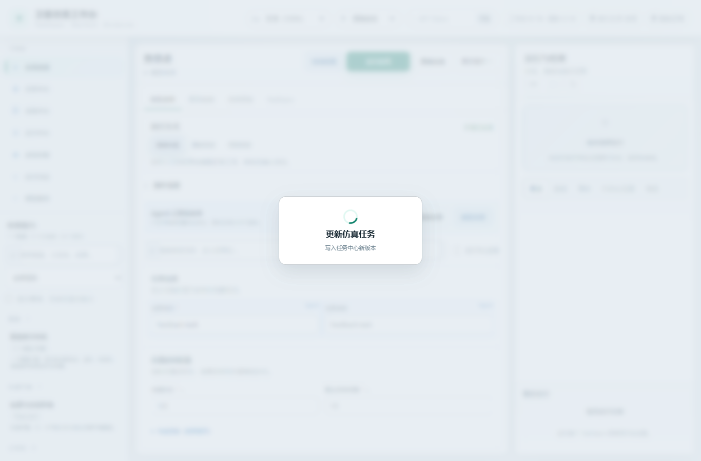
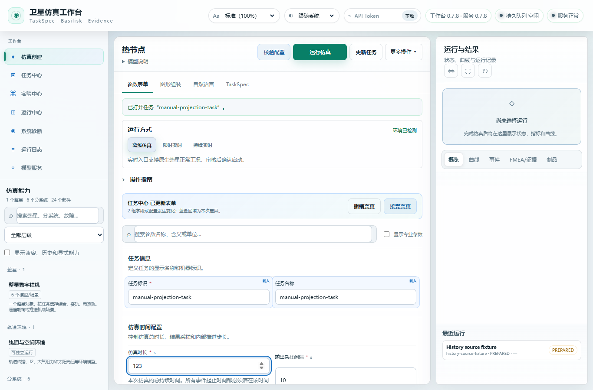
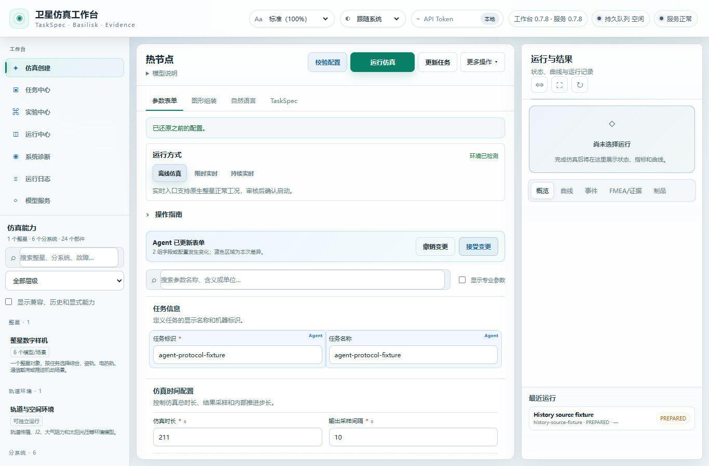

# R30 整合进展检查点

本目录保存可审阅的源码覆盖包和有限工程证据，尚不是完成验收的发布版本。只在本目录整理；没有向 root 应用覆盖、操作 Git、推送、安装环境或控制既有耐久实例。

当前同版 R30 的全套回归、实际模型完整链路、wheel 安装和浏览器验证均为 **PENDING**。整理时 root 报告全套仍在运行，已观察到 1 个失败；实际模型 create22 通过，refine 尚在运行。失败完整归因和终态证据未收齐，不能写成全套通过。具体快照见 [snapshot-status.json](snapshot-status.json)，后续终态应另补最终索引，保留本次快照。

## 源码覆盖包

| 身份 | App | Core |
|---|---|---|
| 未应用覆盖的 root | `4cce6d46062a27bc310cc168c1d9587a458c56b4692bd60cf2c60548c2698f82` | `59d0f3613c8f21e267d8c2fd7886bb3af6a4be71a32f521d3e8b4646133a9cbe` |
| 私有 R30 整合候选 | `953972755f4188ae449ae29182bbe7963c429a5c41e3c19cbcb5e78af07eba1f` | `137dcf2341765077aaace82352bb03f019352cdb3032cb0dcbb3d0cd5e635b9a` |

root HEAD 由 root 核实为 `d4db2d6a54cefc5c72738e9640111e85bbfb4470`。本目录准备者没有执行 Git 命令。

`overlay/` 包含 R30 冻结输入中相对当前 root 有变化的 52 个 `src/scripts/tests/docs` 文本文件，共 1,646,058 字节。每个文件均精确复制原始字节；新增路径、root 当前前像、R30 后像、字节数和来源逐项列于 [source-overlay-manifest.json](source-overlay-manifest.json)。没有需要删除的 root App 文件，清单叠加可精确重建上述 R30 App。该包包含较早隔离候选继承的修复，不仅是最后 R25–R31 的增量。

原始批准白名单为 [whitelist-manifest.json](whitelist-manifest.json)，SHA 为 `aa8b0115e0c33640c3cd4ac35a9b7e7d27bd5e525fe653a9dedebf983467b01e`。源码、合成回归 fixture 和选定证据均以具体路径列入；不会递归收集工作区。

默认动作是**核对**：先按 `application-source-v1` 的规范 JSON 摘要核对 root App，再逐项核对每个 `before_root_sha256`，最后核对覆盖文件的 `after_sha256`。`null` 前像要求目标原本不存在。前像不匹配时应停止核对并查明来源，不能覆盖来凑哈希。root 仍持有冻结耐久实例，本目录不提供自动应用入口，也没有执行覆盖。

## 当前改进和适用范围

- 自然语言修改按时间/容量量纲及字段意图绑定，保留未请求参数、事件开始时间和幅值；没有把固定百分数代填为模型答案。
- 导出保留最终 canonical TaskSpec，并将实际执行计划与导出/执行记录绑定；外部 JSON 的显式修改更新 provenance。
- guided numeric const 解码与原始 schema 最终校验并存；服务取消、断连和独占准入保留实际工作线程证据。
- 保存或更新任务是可见主操作；写入未结束时显示处理中，避免旧成功提示被误读为本次完成。任务中心、TaskSpec、历史 Run 与 Agent 的投影来源分别显示，保留真实修改高亮。
- 工作台设计笔记记录了对 Carbon 表单分组、渐进披露，以及 Grafana 图表聚焦组织的参考，见 [设计说明](evidence/compact-workbench-design-note.md)。这是交互组织参考，不代表外部认可或完成全部视觉验收。

卫星真实性目标仍为通用近地小卫星工程仿真，依据可追溯假设和披露边界评估。容量骤降可能使储能裁剪或不可用，裁掉的能量没有自动进入热源；energy bounds/power proxy 不能充当完整守恒证明。说明见 [资源损失语义](overlay/docs/native_resource_loss_events.md) 与 [热环境假设](overlay/docs/native_thermal_environment.md)。这些工程假设没有被改写为特定硬件飞行标定结论。

## 已封存证据，各自保留 App 范围

| 证据 | 已观察结果 | 范围 |
|---|---|---|
| R25 CPU / GPU | CPU 57 项通过；GPU HTTP 控制 37 个检查通过 | 单独组件/服务准入、取消、真实断连和原 strict schema 复用，不是 37 项模型准确率 |
| R26 | 49 个不同 pytest 节点；21 个离线原生检查通过 | App `6253eab…`，canonical 导出和执行绑定 |
| R27 | 原失败节点 8、定向 76、新边界 32，116 个不同节点 | App `11d1e0…`，时间和 Wh 文字语法 |
| R28 | 2 个不同功能浏览器节点通过，另有截图复验 | App `aa11ce…`，保存反馈；不是一次 3 项通过 |
| R29 | v4 新测试 13 项通过；同生产源码通过节点并集 78 | App `3d9643…`，不是一次 78 项通过；原 v3 两条失败记录保留 |
| R31 | 同生产源码 15 个不同浏览器节点通过 | App `72d7e1…`，来源标签及公开键盘菜单导航；不是单次 15 项运行 |

原样小型索引位于 `evidence/component-*.index.json`；R27 索引含绝对本机路径，公开的是 [明确标注的派生摘要](evidence/component-r27.summary.json)。源索引 SHA 和原件相对路径保留，原件仍在私有归档。不同 App 的结果不相加成 R30 同版通过总数，组件证据也不替代 R30 全套结果。

旧失败保留：

- R20 full v2 为 **2152 PASS / 12 FAIL / 6 SKIP / 2 WARN**。公开 [JUnit 摘要](evidence/r20-full-junit.summary.json) 与 [失败归因摘要](evidence/r20-full-triage.summary.json) 均标明派生性质和原始 SHA；原 JUnit、日志、triage 没有修改或重判。
- R24 实际模型 create17 和原生验证通过，但 `runtime_plan_matches_validated_plan` 为 false，整次仍是 **FAILED_NO_SUBSTITUTION**，见 [原计划绑定失败摘要](evidence/r24-real-ai-plan-failure.summary.json)。后续组件修复不追改这次失败。

## 已实际看图的有限展示

R28：PUT 尚未结束时的阻塞操作层，不是保存完成截图。

R31：任务中心来源及“载入”字段徽标；更新任务可见。历史 fixture 的 PREPARED 状态没有被写成已执行。

R31：撤销重置后保留 Agent 来源和 211 参数值。这是受控 UI 协议 fixture，不是新模型回答。三图均实际打开查看后原样复制，SHA 和观察记录见 [图像摘要](evidence/image-review.summary.json)。它们分别属于 R28/R31，不冒称已完成 R30 同版浏览器验收。

## 包含与排除

不纳入 venv、依赖环境、模型/adapter/tokenizer 权重、缓存、训练运行目录、provider 配置、密钥/私有环境文件或全量原始遥测。带绝对环境路径的元数据保留本机原件，公开摘要明确说明派生方法和来源 SHA。这里只做有限的显式白名单及内容/路径核对，不作 secret-free 声明。

使用 uv 的环境与冻结依赖仍由项目安装流程管理，环境本身不随本检查点上传。wheel/新浏览器等验收需针对上述 R30 身份独立完成。当前目录供 root 审阅和后续补充终态总索引，准备者不执行 push。
